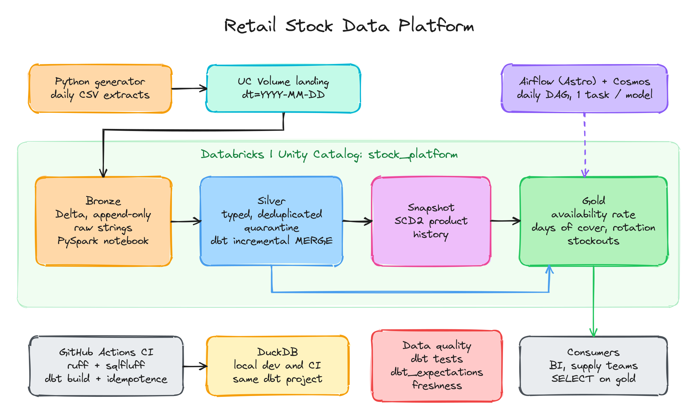
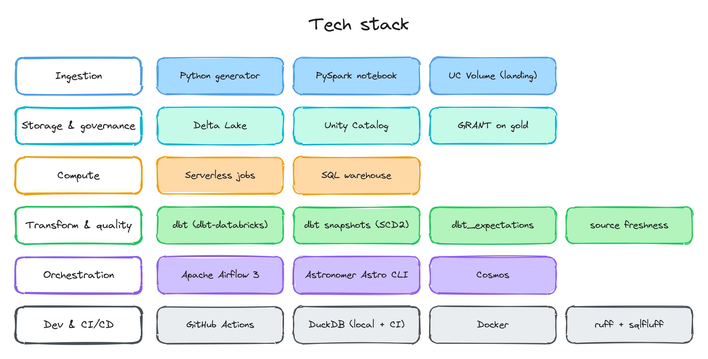
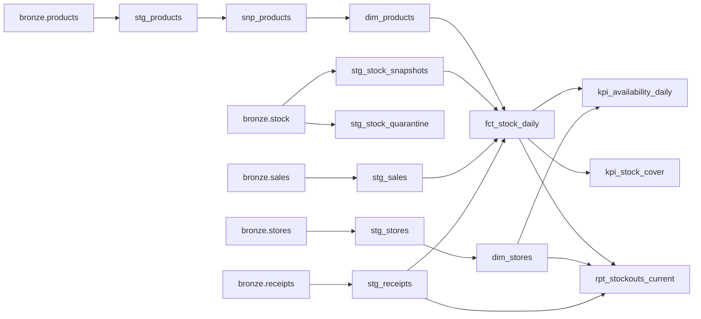
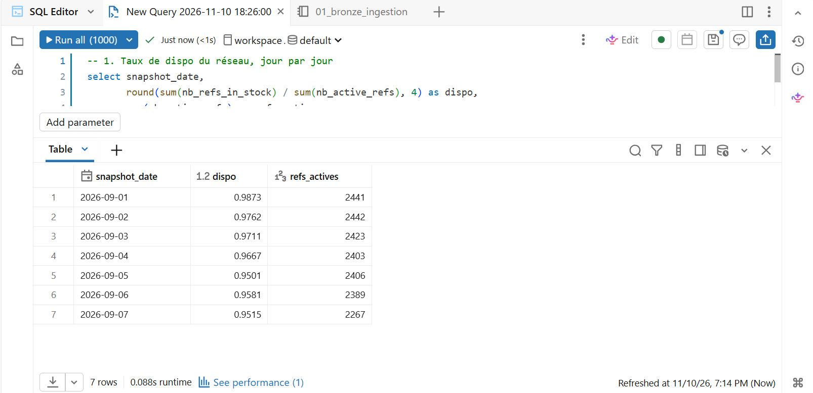
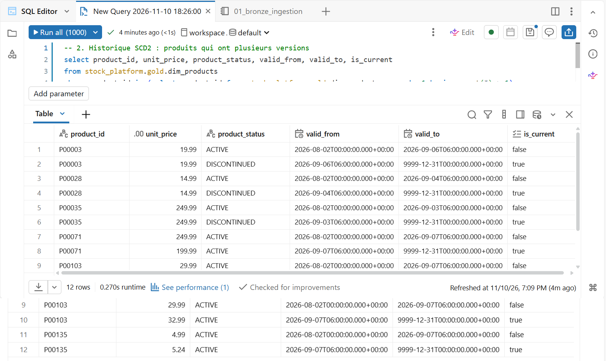
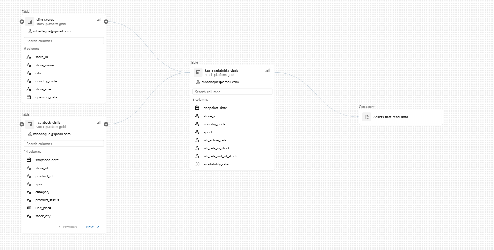
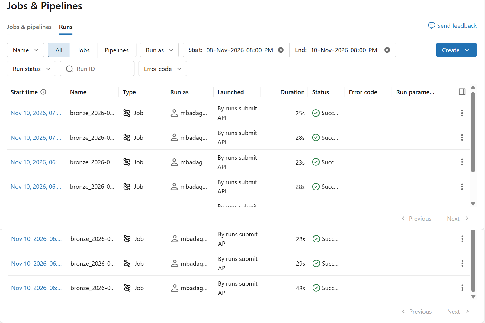

# Retail Stock Data Platform

End-to-end data platform for **retail stock data**: a medallion architecture (bronze, silver, gold) on **Databricks / Delta Lake**, transformations and tests with **dbt**, orchestration with **Airflow (Astronomer) + Cosmos**, and **CI/CD on GitHub Actions**.

The gold layer exposes the indicators a stock data team works with every day:

* **Availability rate** ("taux de dispo"): share of active references with stock > 0 at end of day
* **Days of cover**: how many days the current stock lasts at the current sales pace
* **Rotation rate** ("vitesse de rotation"): units sold over a window / average stock over that window
* **Current stockouts**: references out of stock today, how long they have been out of stock, last supplier receipt

The data is synthetic (Python generator) but behaves like real data: a replenishment policy with supplier lead times, late suppliers, discontinued products, a product referential that changes over time, and **anomalies injected on purpose** (negative stock, duplicated sales lines, a store that did not send its snapshot).

The same dbt project runs on **two targets**: DuckDB (local development and CI, free and fast) and Databricks (the real platform).

---

## Architecture



### Tech stack



> Editable sources: [`docs/architecture.excalidraw`](docs/architecture.excalidraw) and [`docs/stack.excalidraw`](docs/stack.excalidraw) (open them on [excalidraw.com](https://excalidraw.com) with *Open*, edit, then *Export image* as PNG).

| Layer | Tool | What happens |
|---|---|---|
| **Bronze** | PySpark notebook (Databricks) or Python + DuckDB (local) | CSV files of the day are appended as raw strings to Delta tables, with `_ingested_at`, `_source_file`, `_partition_date` |
| **Silver** | dbt | Typing, deduplication (`qualify row_number()`), invalid rows sent to quarantine, incremental models upserted on their grain |
| **Snapshot** | dbt snapshot | SCD2 history of the product referential (price, category, status) |
| **Gold** | dbt | Daily stock fact + KPI tables, granted to the `stock_consumers` group |

### dbt lineage



> Interactive lineage: `make docs` (dbt docs on http://localhost:8081). The CI also publishes the dbt docs as a build artifact.

---

## Running on Databricks

The pipeline runs on **Databricks Free Edition** (serverless compute, Unity Catalog, serverless SQL warehouse): 7 simulated days, each one = the bronze notebook submitted as a serverless job, then `dbt build` on the SQL warehouse (`scripts/run_databricks_pipeline.sh`). Every run passes all blocking tests (`PASS=52 WARN=1 ERROR=0` on day 1, the warning being the negative stock row caught by the quarantine).

**Availability rate per day** (`gold.kpi_availability_daily`). It decreases from 98.7 % to 95.2 % as stockouts build up before the first supplier receipts (day 3), with a low point on Saturday (peak demand). The number of active references drops when products are discontinued, and on day 7 because store S007 did not send its snapshot (injected anomaly, caught by the completeness test).



**SCD2 history of the product referential** (`gold.dim_products`, from the dbt snapshot): discontinued products and the Monday price review, each version with its validity range.



**Unity Catalog lineage** of the availability KPI:



**Bronze ingestion runs** (serverless jobs submitted through the Jobs API):



---

## Key design choices

**Idempotence, end to end.** Bronze is append-only, so replaying a day creates duplicates in bronze on purpose. Silver deduplicates on the business grain and incremental models are **upserted** on their unique key (`MERGE` on Databricks, `delete+insert` on DuckDB). Replaying a day overwrites it: same result, no duplicates. The CI checks it: it replays the last day and verifies that row counts do not change.

**Incremental with a lookback.** Incremental models re-process the last `lookback_days` (default 3) to absorb late data. The filter uses `coalesce(max(...), '1900-01-01')`: without it, an empty target (first run on a day without receipts) makes `max()` null, and `x > null` silently filters every future row. This bug came up while building the project and is now covered by the stock balance test.

**History where it matters.** The availability rate only counts **active** references, and a product's status changes over time. `fct_stock_daily` joins each day to the product version valid at the end of that day (SCD2 from the dbt snapshot), so a product discontinued on the 15th still counts in the availability of the 14th.

**Ratios that can be re-aggregated.** `kpi_availability_daily` exposes the numerator and denominator (`nb_refs_in_stock`, `nb_active_refs`) next to the rate, so consumers can compute availability per country or for the whole network without averaging ratios.

**Data quality that does not hide problems.** Blocking tests (`error`) protect the grain and the business rules of the models. Anomalies coming from upstream are **reported without blocking** (`warn`): rows in quarantine, a store missing from the daily snapshot, a stock balance that does not reconcile.

**Gaps and islands for stockout streaks.** `rpt_stockouts_current` computes how many consecutive days a reference has been out of stock with a running count of in-stock days (constant during a stockout streak).

---

## Data quality

| Check | Type | Severity |
|---|---|---|
| Unique / not null keys on every model, compound grain uniqueness (`dbt_expectations.expect_compound_columns_to_be_unique`) | generic | error |
| Referential integrity: stock rows point to known stores and products (`relationships`) | generic | error |
| Business rules: `stock_qty >= 0`, `unit_price > 0`, `availability_rate` between 0 and 1 (`dbt_expectations`) | generic | error |
| Accepted values: store size, product status, sales channel | generic | error |
| Source freshness on bronze (`_ingested_at`): warn after 26 h, error after 48 h (stock, sales) | freshness | warn / error |
| Quarantine is empty (negative or non-numeric stock) | generic | warn |
| Every store sent its stock snapshot every day | singular | warn |
| Stock balance: `stock(d) = stock(d-1) + receipts(d) - sales(d)` | singular | warn |

On the generated data, the warnings fire as expected: the quarantine catches the injected negative stock values and the completeness test catches the store that did not send its snapshot on one day.

---

## Run it

### 1. Local, on DuckDB (no cloud account needed)

```bash
python -m venv .venv && source .venv/bin/activate
make install
make run DAYS=30        # generates 30 days, then one bronze + dbt build per day
make docs               # lineage and documentation
```

One run per simulated day is what lets the dbt snapshot build a real SCD2 history. The warehouse ends up in `data/warehouse.duckdb`:

```bash
duckdb data/warehouse.duckdb "select snapshot_date, sum(nb_refs_in_stock) / sum(nb_active_refs) as availability from gold.kpi_availability_daily group by 1 order by 1 desc limit 7"
```

On 30 simulated days (20 stores, 150 products, about 2,300 active store x product references per day), network availability is around **95-96 %**, average days of cover around 16 days.

### 2. Airflow with Astronomer (Astro CLI) + Cosmos

The repository root is an Astro project (`Dockerfile`, `requirements.txt`, `dags/`).

```bash
cp .env.example .env    # DBT_TARGET=duckdb by default
astro dev start         # Airflow UI on http://localhost:8080
astro dev run backfill create --dag-id stock_platform_daily --from-date 2026-09-01 --to-date 2026-09-30
```

The DAG `stock_platform_daily` runs, for each day:

```
check_landing -> bronze_ingestion -> source_freshness -> dbt_build (task group)
```

Cosmos turns every dbt model and snapshot into its own Airflow task, with the model's tests right after it (`TestBehavior.AFTER_EACH`). A failure is visible and retryable at model level instead of one big `dbt build` task. Runs are sequential (`max_active_runs=1`) because incremental models and snapshots depend on the previous day. In local mode, dbt tasks share a one-slot pool because DuckDB accepts a single writer.

### 3. Databricks (tested on Free Edition)

1. Create a workspace on [Databricks Free Edition](https://www.databricks.com/learn/free-edition).
2. Run `databricks/setup/00_unity_catalog_setup.sql` in the SQL editor: catalog `stock_platform`, schemas `bronze` / `silver` / `snapshots` / `gold`, volume `bronze.landing`, grants. Create the `stock_consumers` group first (workspace settings, Identity and access), or run dbt with `--vars '{consumer_group: ""}'` to skip grants.
3. Upload the landing zone to the volume:
   ```bash
   make data DAYS=30
   databricks fs cp -r data/landing dbfs:/Volumes/stock_platform/bronze/landing
   ```
4. Import `databricks/notebooks/01_bronze_ingestion.py` in the workspace and run it with `run_date=2026-09-01` (or let Airflow do it).
5. Point dbt at the SQL warehouse (Git Bash on Windows: also `export MSYS_NO_PATHCONV=1`):
   ```bash
   export DBT_TARGET=databricks DATABRICKS_HOST=... DATABRICKS_HTTP_PATH=... DATABRICKS_TOKEN=...
   cd dbt && dbt deps && dbt build --profiles-dir profiles
   ```
6. Replay the following days one by one: `scripts/run_databricks_pipeline.sh 2026-09-02 6` (add `CONSUMER_GROUP=stock_consumers` in front to apply the gold grants)
7. With Airflow: set `DBT_TARGET=databricks` and the Databricks variables in `.env`. The bronze task then submits the notebook as a serverless job (`DatabricksSubmitRunOperator`) and dbt runs on the SQL warehouse.

Free Edition limits to keep in mind: serverless compute only (no custom clusters), one 2X-Small SQL warehouse, no Scala. Enough for this project.

---

## CI/CD (GitHub Actions)

`.github/workflows/ci.yml`, on every pull request and on `main`:

1. **lint**: `ruff` (Python) and `sqlfluff` with the dbt templater (SQL)
2. **build**: 10 simulated days on DuckDB (`dbt build` each day, all tests), an idempotence check (replay the last day, row counts must not change), dbt docs published as an artifact
3. **databricks** (on `main`, only if the `DATABRICKS_*` secrets are set): `dbt build` on Databricks

---

## Repository layout

```
.
├── docs/                             architecture and stack diagrams (Excalidraw), Databricks screenshots
├── generator/generate_data.py          synthetic stock / sales / receipts / referential data
├── scripts/
│   ├── load_bronze_local.py            bronze ingestion into DuckDB (mirror of the notebook)
│   ├── run_local_pipeline.sh           local end-to-end run, one run per simulated day
│   └── run_databricks_pipeline.sh      same on Databricks (serverless job + dbt on SQL warehouse)
├── databricks/
│   ├── setup/00_unity_catalog_setup.sql catalog, schemas, volume, grants
│   └── notebooks/01_bronze_ingestion.py PySpark bronze ingestion into Delta
├── dbt/
│   ├── models/sources/                 bronze sources + freshness
│   ├── models/silver/                  stg_* (typing, dedup, quarantine, incremental)
│   ├── snapshots/snp_products.yml      SCD2 product referential
│   ├── models/gold/                    dims, fct_stock_daily, KPIs, stockout report
│   ├── tests/                          singular tests (completeness, stock balance)
│   ├── macros/                         schema naming, upsert strategy per adapter, grants
│   └── profiles/profiles.yml           duckdb + databricks targets (env vars)
├── dags/stock_platform_daily.py        Airflow DAG (Cosmos)
├── Dockerfile, requirements.txt        Astro project
└── .github/workflows/ci.yml            CI/CD
```

---

## Next steps

* Replace the bronze notebook with **Auto Loader** / Lakeflow Declarative Pipelines for file discovery and schema evolution
* **Model contracts** on gold models (enforced column types) to formalize the interface with consumers
* Lineage export with **OpenLineage** from Airflow
* Monitor the KPIs themselves (e.g. alert when the availability of a store drops by more than 5 points day over day)
* A naive 7-day stockout forecast from days of cover and pending receipts
